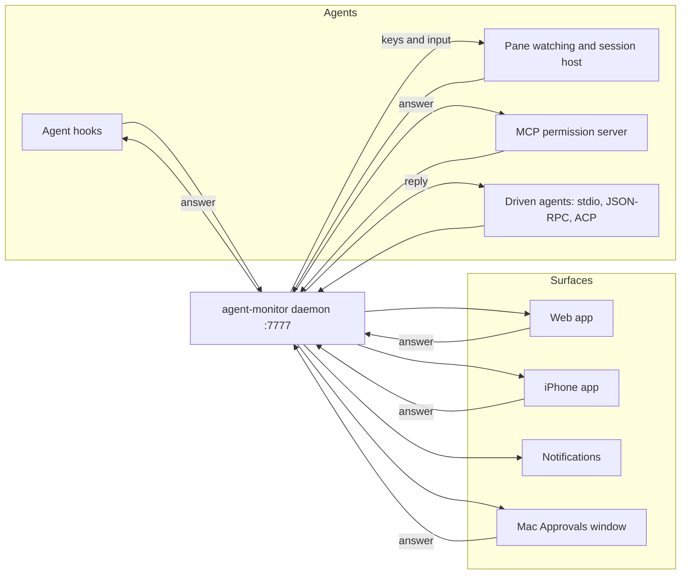

# agent-monitor

agent-monitor is one Go daemon for the coding agents on your Mac. It watches every Claude Code, Codex,
Cursor, opencode and cursor-agent session that runs in a terminal. It can also start and drive agents
itself: Claude Code, Codex and any agent that speaks the Agent Client Protocol (ACP). One web app shows
all of them, answers their permission prompts, and works from a phone over Tailscale. An iPhone app
uses the same daemon.



Website: [agent-monitor-5xo.pages.dev](https://agent-monitor-5xo.pages.dev)

## Why

- You run many agent sessions in many terminals. No single place shows which one works, which one is
  done and which one waits for you.
- An agent stops at a permission prompt. It waits until you come back to the terminal, and you lose
  time when you are away.
- Each agent has its own transcript format, so you cannot search your past sessions in one place.
- You want to see and answer your agents from a phone, without a cloud service between you and your Mac.

agent-monitor puts all sessions in one list, brings every prompt to the surface where you are, and
sends your answer back to the agent.

## What you get

**Workspace and threads**

- One thread list for watched sessions (started in a terminal) and driven threads (started and owned by
  agent-monitor). Groups: Needs you, Working, Ready and Settled.
- Pin, settle and snooze a thread. A thread that is done for more than 24 hours settles by itself.
- Subagents: a driven thread can start child threads, and the right panel shows them as a tree.
- A live activity line and a step trail in the chat show what the agent does now and which tool calls it ran.
- In a watched session (a Claude Code or Codex session started in a terminal), a live row above the
  composer lists the subagents that run now, with type, task and elapsed time. Tap one to read its
  transcript.
- Empty watched sessions (no messages) hide behind a "Show N empty sessions" link.

**Approvals and rules**

- Permission prompts, questions and plan approvals from the web app, the iPhone app and the Mac
  Approvals window.
- Risk level and reason on each request. Rules allow, deny or hold by agent, tool, pattern and folder.
- **Always** makes a rule only as wide as the call you saw, or applies the permission suggestions of
  the Claude CLI.
- Suggested rules: the daemon reads 30 days of approvals and proposes an allow rule for a call that you
  approved 3 or more times and never denied. Add or dismiss each one in Rules (web) or Settings (iPhone).
- **Allow these N** answers a group of the same request from several sessions at once.

**Needs-you alerts and reminders**

- Notices when a thread needs you, finishes, fails or reaches a spend limit.
- A reminder repeats an unanswered needs-you alert once (10 minutes by default, set in Settings).
- Open alerts survive a daemon restart, and an alert closes on every device when you answer it on one.
- Toasts, a notification centre, Web Push and macOS notifications.

**Search**

- Full-text search over every transcript on the machine, with filters and an Ask mode that answers with
  citations.
- Agents can search the same history through two read-only MCP tools.

**Phone, iPhone app and pairing**

- The web app works from a phone over Tailscale. The iPhone app is a SwiftUI app for the same daemon,
  with Stop, the message queue, a diff viewer and saved replies.
- Pair a device with a one-time link. Revoke it at any time.

**Git panel and diff**

- Checkpoints, diff, restore, commit, push, Create PR, merge of worktree threads and a read-only review.

**Terminal sessions and agent-to-agent talk**

- A terminal panel, a session host (`agent-monitor run`) and a pane viewer.
- Agents message each other with MCP tools or with the `agent-monitor` command line.

**Spend limits**

- Limits per thread and per day in US dollars, with a notice at 80% and a stop at 100%.

**Templates and schedules**

- Saved New thread forms with variables, and cron schedules that run inside the daemon.

## How it works

Three sources feed the daemon. The daemon shows the result on every surface. Your answer goes back to the
agent by the path it came from.



1. An agent produces an event: a hook call, a screen change in a registered pane, or a request to the
   MCP permission server. A driven agent talks to the daemon directly.
2. The daemon on port 7777 stores the event, links it to a thread and decides whether you must act.
3. The web app, the iPhone app, the Mac Approvals window and notifications show the thread and the
   request.
4. You answer on one surface. The daemon sends the answer to the agent, and closes the same card on
   the other surfaces.

## Design

- **Registered, not inferred.** The daemon never guesses which tmux pane belongs to which agent. Hooks,
  `agent-monitor run` and a pane picker register the pane, and a registration is the truth.
- **Loopback is trusted, other devices must prove themselves.** The daemon always listens on
  `127.0.0.1`. Other devices use a password or a paired device token.
- **The MCP server is a separate process.** It is the `am-helper` binary, which each agent starts itself.
- **One daemon, one state folder.** Everything lives in `~/.agent-monitor/`.

Read more:

- [docs/DESIGN.md](docs/DESIGN.md): the reasons behind these choices and what we do not build.
- [docs/V3-SPEC.md](docs/V3-SPEC.md): the API and protocol reference.
- [docs/CHANGES.md](docs/CHANGES.md): what this branch adds.

## Install and quick start

```bash
go build -o agent-monitor ./cmd/agent-monitor   # web/dist is committed, so go build alone works
./agent-monitor install                          # hooks and MCP entries for Claude Code and Codex
./agent-monitor                                  # the daemon, on http://localhost:7777
```

Run `bin/build.sh` after you change anything under `web/`. It runs the CSS collision check, the
markdown check, `npm run build` and `go build`, so the new web app is embedded in the binary.

The CSS collision check (`bin/css-collisions.py`) fails when a change defines a selector one more time,
or styles a global class inside a new context. Both broke the layout before. If the override is
intended, run `bin/css-collisions.py --update` and commit `web/css-baseline.txt`.

Required native helper: `rust/am-helper/build.sh ~/agent-monitor` builds `am-helper` and puts it next to
the binary. It serves `mcp-perm-server`, `run` and `__pty-leader`. The Go binary has no copy of these modes
and exits with an error when `am-helper` is missing. See `rust/am-helper/PROTOCOL.md`.

Lifecycle:

```bash
agent-monitor            # run the daemon in the foreground
agent-monitor stop       # stop only the process that listens on the port
agent-monitor restart    # stop, then start
```

Do not use `pkill -f agent-monitor`. That pattern also kills the `agent-monitor mcp-perm-server`
children that Claude and Codex started, and those CLIs do not reconnect their MCP server.

## The Workspace

The Workspace (`/w`) is the home page. It lists two kinds of threads in one list:

- **Watched threads** are agent sessions that you started in a terminal. agent-monitor reads their
  transcripts and shows them as full threads: prompts, replies, commands, file changes and cost. When the
  session runs in a registered tmux pane, the composer types into that pane.
- **Driven threads** are agent processes that agent-monitor starts and owns. You start them from
  New thread (`/w/new`). The daemon talks to the agent over its own protocol, so the chat, approvals,
  stop and steer work without tmux.

The list groups threads as Needs you, Working, Ready and Settled. Pin, settle (`e`) and snooze (`z`) a
thread from its row menu or with the keys. A thread that is done for more than 24 hours settles by
itself.

### Starting a session

You can start a session in two places:

- **From a terminal.** Run `claude` or `codex` as usual. With the shell functions in
  [Session host](#session-host), they run under `agent-monitor run`, with or without tmux (your choice).
- **From agent-monitor.** New thread (web, phone and the floating panel) has a **Where** choice:
  - **In a terminal** (the default for Claude and Codex): agent-monitor runs
    `tmux new-session -d -s am-<id> agent-monitor run <agent> <flags>` and types your prompt when the agent
    is ready. The page shows "Starting Claude in tmux session am-xxxx" with a copyable
    `tmux attach -t am-xxxx`, and opens the session's thread when its first hook links it. Sessions that
    agent-monitor starts always run in tmux, so you can attach from any terminal.
  - **Headless**: a driven thread (below). Fan-out rows and ACP agents are always headless.

  The agent options become CLI flags: Claude `--model` and `--permission-mode`; Codex `--model`,
  `-s <sandbox>` and `-a <approval policy>`. The daemon accepts only allow-listed values, so a phone can
  set them too.

**Continue here** turns an ended watched session into a driven thread. It keeps the session id, the
folder and the model, so the agent resumes with its full history.

Other views stay under **More**: Desk (an overview), Control room (dense and dark), Messages (chat
style), Timeline, Board, Explore spans, Errors, Tracing, Monitors, Intelligence and Rules. The classic
UI is at `/classic`. `⌘K` or `/` opens the quick search.

## Search

agent-monitor indexes every transcript on this machine (prompts, replies, commands, tool output,
errors, edited files) in a full-text index, `search.db`.

- **Thread filter.** The box above the thread list filters titles at once. From 2 characters it also
  searches the transcripts and adds **In transcripts**: one row per session with the agent, title,
  repo, age, number of hits and the best snippet. Enter opens the top result.
- **Search page** (`/w/search`, the Search entry of the rail). Facets for agent, repo, tool and time,
  results grouped by session, and every snippet of a session on demand.
- **Query syntax.** Plain words and `"phrases"`, plus `agent:` `repo:` `tool:` `kind:` `file:`
  `is:error` `since:` `until:` (`24h`, `7d`, `today`, `monday`, `2026-11-01`). Words such as `codex`,
  `failed` or `yesterday` turn into the same filters. Filters show as chips.
- **Opening a hit** goes to `/w/{thread}?hit=...`. The thread scrolls to the matched turn, pages back
  through older turns when needed, and highlights the matched item for a few seconds.
- **Session tabs.** A watched thread with more than one session (after `/clear` or a resume) shows
  one tab per session, newest first, with its start time, first prompt and turn count. A hit opens
  the tab of its session.
- **Ask** (on the search page) sends the 20 best matching lines to the enrichment model and answers
  with citations that link to the sessions. Each question is a paid model call that counts toward the
  daily cap. It needs model calls turned on under Rules.

Agents can search the same history. The MCP server gives every session, watched or driven, two
read-only tools:

- `search_sessions {query, agent?, repo?, since?, limit?}`: matching sessions with id, agent, title,
  repo, folder, last activity, hit count, the top 3 snippets as plain text and the Workspace URL.
  `limit` is 10 by default and at most 50.
- `session_context {sessionId, turn?, around?}`: the turns around a hit as plain text, at most 8 KB.

Ask any agent "list my previous sessions about the stg tunnel" and it calls `search_sessions`.

## Agents

| Agent | How agent-monitor drives it |
|---|---|
| Claude Code | `claude -p` with stream-json input and output, and the permission prompt tool on stdio |
| Codex | `codex app-server` (JSON-RPC) |
| opencode | ACP: `opencode acp` |
| Cursor agent | ACP: `cursor-agent acp` |
| Gemini CLI | ACP: `gemini --experimental-acp` (shown as not installed when the binary is missing) |

New thread shows the agents that are installed. You can add more ACP agents in
`~/.agent-monitor/acp-agents.json` as `[{id, name, command, args, env}]`.

Each driven thread has a folder and a workspace:

- **Here**: the agent works in the folder you picked.
- **Worktree**: agent-monitor runs `git worktree add` under `~/.agent-monitor/wt/` on a new branch
  `am/<slug>-<id>`, and the agent works there.
- **Read-only**: Codex runs in its read-only sandbox. Claude cannot use the edit tools, and each Bash
  command must be on a strict read-only list or you must approve it. ACP agents must accept plan mode.

Claude threads also take a permission mode: Ask each time, Accept edits, Plan first, or Auto.

Messages can carry images (paste or drop them in the composer). The composer completes `@` file paths,
`$` skills and Codex prompts, and `/` commands.

A message sent while a driven thread works waits in the queue above the composer and goes when the agent
is idle, one message per turn. For a terminal session that agent-monitor can reach (a session host or a
tmux pane), the composer types the message straight into the CLI, as if you typed it there: a busy
Claude Code or Codex queues it itself. agent-monitor's own queue stays for driven threads, and for a
terminal message that cannot go now (a question or permission prompt is open).

Claude Code's own queue shows above the composer as "Queued in Claude Code", whether you typed the
message here or in the terminal. agent-monitor reads it from the `queue-operation` records in the
transcript, shows your messages and hides Claude Code's own notifications (one click shows them), and the
thread list shows "N queued". Claude Code 2.1.326 gives its queue back only all at once, so the actions
match its keys:

- `ctrl+s` Send now: Esc stops the current turn, then Claude Code sends every queued message as the next turn.
- `Enter` Edit: Up moves every queued message into Claude Code's input box; agent-monitor clears the box
  and puts the text in its own composer.
- `ctrl+x` Remove: works when one message is queued. With more, use Edit and send back the ones you want.

`↑` from an empty composer selects the newest queued message; for agent-monitor's queue `ctrl+s` sends it
now (a steer for a driven thread), `ctrl+x` removes it, `Enter` puts it back in the composer to edit.
`Esc` leaves the list. The keys go only while Claude Code shows its "Press up to edit queued messages"
hint and no prompt. Codex 0.169 does not record its queue, so Codex queues show only in its terminal.

## All commands

Every command in a session shows in its thread: the agent's tool calls, the `!` commands you run, slash
commands with their arguments and local output (`/model`, `/compact`, skills), and the real output of a
`!` command that Claude Code moved to the background (the daemon follows its output file). Your commands
show as yours. They also show in the trace view (marked "you"), and search finds them: they are
indexed as `kind:command` with `tool:user`. A Codex `!` command before the first prompt opens its own
turn, as a leading Claude local command does.

## Approvals

agent-monitor answers permission prompts, questions (AskUserQuestion) and plan approvals (ExitPlanMode)
from the web app, the iPhone app or the Mac app's Approvals window.

- For **driven threads** every prompt reaches agent-monitor directly.
- For **watched sessions**, add the HTTP hooks that the Rules page shows (`GET /api/approvals/hooks-snippet`).
  agent-monitor does not write them for you.
- **Approvals and questions show in both places.** When the session has a session host or a registered
  tmux pane, the prompt shows in the terminal at once, and the same card shows in the web app, on the
  iPhone and in the Mac Approvals window. Answer in either place. A card answer is typed into the terminal as keys; an
  answer in the terminal closes the card everywhere ("answered in terminal"). Auto rules still answer at
  once. A session with no host and no pane keeps the old behaviour: the prompt is held until you answer
  or the wait ends. The setting `approvalsMode` is `"both"` (default) or `"hold"` (hold every prompt).

Each request has a risk level (low, medium, high) and a reason. **Rules** allow, deny or hold requests
by agent, tool, pattern and folder. Deny rules win over allow rules. **Always** creates a rule only as
wide as the call you saw: it is not offered when no narrow pattern exists. Allow rules never answer a
read-only thread.

Keys: `a` allow, `A` always, `d` deny, `j` and `k` move. High-risk requests and plans need a second
press. You can turn single-key approval off in the help overlay (`?`) or the More menu.

## Subagents

A driven thread can start child threads. The agent-monitor MCP server gives driven agents three tools:
`delegate_task`, `wait_tasks` and `task_status`. New thread can also start a parent with several
children at once (fan-out).

- A child is never less restricted than its parent.
- Limits: depth 2, 8 running children per parent, 32 subagents per root thread.
- When the last child ends and the parent is idle, the parent gets one message with each child's
  result. The results are fenced and marked as untrusted subagent output.
- Closing a parent closes its children. Stop on a waiting parent interrupts the children too.

The right panel shows the lineage as a tree.

Subagents of a watched session (for example Claude Code's Agent tool) show in a live row above the
composer, on the web and on the iPhone. The list is checked every 45 s on the web and every 20 s on the
iPhone, and every 5 s while a child runs. In a driven thread, the web chat shows a subagent card with
each child's state and time, and the iPhone shows a live row above the composer for the children that run.

## Git panel

Driven threads in a git repository get a Git box:

- **Checkpoints**: at the start and end of each run, agent-monitor snapshots the work tree to
  `refs/am/cp/<thread>/...` without touching your index, HEAD or branches. Each run has a Diff link.
- **Diff** between any two checkpoints, the thread base, HEAD and the work tree.
- **Restore** a checkpoint. A safety checkpoint comes first, and restore never deletes ignored files.
- **Commit**, **Push** (never to main, master or the default branch) and **Create PR** (`gh pr create`,
  draft by default). Your own git config and hooks apply. No trailers are added.
- **Merge** a worktree thread into its origin branch (squash or merge) with `git merge-tree`. Merge
  needs git 2.38 or later, never runs hooks and never pushes.
- **Review**: a read-only child (Codex by default) reviews the thread's diff. Its findings show as a
  card, grouped by severity, and each one has "Ask the agent to fix".
- **Open** the folder in your editor, a tmux window or Finder (only from the Mac itself).

Watched threads get a read-only Git box for their folder.

## Terminal

The Terminal panel opens a login shell (`$SHELL -l`) on a pty in the thread folder. Each thread has one
shell. It stays 30 minutes after the last tab leaves, and a reconnect replays the last 256 KB. At most 6
shells run at once.

From another device the terminal is off by default. To allow it, turn on `remoteTerminal` on the Mac,
and use a paired device. The password alone never opens a terminal.

## Notifications

agent-monitor notifies you when a driven thread needs you, finishes, fails, or reaches a spend
limit. A fan-out sends one notice when all of its children end.

- The web app shows toasts and a notification centre at `/notifications`.
- Web Push works on a secure origin (for example `tailscale serve`). The VAPID keys are generated once
  on your Mac, and no third-party service is used.
- The Mac app reads the same stream and posts macOS notifications.
- The iPhone app asks for notification permission at its first alert, not at launch, and shows that
  alert after you allow it.

Settings → Notifications sets each kind on or off, quiet hours, and a batch window (20 seconds by
default).

## Approvals window

The Mac app `agent-monitor.app` (`./desk/build.sh`) has no floating panel and no TV Watcher any more.
It has an **Approvals** window instead. The window hosts the `/approvals` page of the daemon, and it
shows itself when an agent waits for you:

- **When it shows**: a new item in `GET /api/needs-you` (the list every surface draws): a permission
  request, a question or plan in a terminal, an MCP prompt, or a driven thread that failed. It does not
  show while agent-monitor.app is the front app (the main window lists the same items); it shows when
  you switch to another app. It opens over full-screen apps and does not take keyboard focus until you
  click it.
- **When it hides**: the queue runs empty. It hides 3 seconds later, but not while the pointer is on it
  or while you type in it. A window that you open on an empty queue stays open.
- **Close**: when you close it while requests wait, it does not show again for those requests. A new
  request shows it again.
- **Settings**: agent-monitor > Show Approvals Automatically (on by default). Window > Approvals (or
  Control-Option-Space) shows or hides it. The window opens at the top right of the screen with the
  pointer, and keeps the place you drag it to.
- **Keys**: Enter or A allows, D denies, 1 to 9 picks an option, J and K (or the arrow keys) move between
  requests, U undoes, Esc hides the window. A high-risk request and a plan need a second press.
  A decision waits 3 seconds with **Undo** before it is sent.

`/approvals` also works in a browser. `/float` and `/tv` stay for browsers and the iPhone; the Mac app
does not open them. AgentFloat.app, AgentTV.app and AgentBar.app are gone: delete any copy you still have.

## Spend limits

Settings → Limits sets a limit per thread and per day in US dollars (0 means off). Claude and ACP agents
report their cost. Codex reports tokens only, so agent-monitor prices them with your rates per model,
or with a built-in price table when you set no rate.

At 80% you get a notice. At 100% the running driven threads of that scope stop, and new turns answer
402 until you raise the limit or click **Allow this thread once more**.

## Templates and schedules

A template is a saved New thread form: agent, model, mode, workspace, prompt, children and an optional
review at the end. Prompts take variables: `{{cwd}}`, `{{branch}}`, `{{date}}` and your own. Two
built-in templates come with the app: "Fix and review" and "Read-only investigation".

A template also has **Where**: In a terminal (the default for new templates) or Headless. A template
with children runs headless. Templates saved before this field run headless. In a terminal, the
Worktree workspace does not apply, and Read-only becomes Claude plan mode or the Codex read-only sandbox.

A schedule runs a template on a cron expression (5 fields, local time) inside the daemon. No LaunchAgent
or cron entry is made. Missed runs are not replayed: one catch-up run starts at most, and it is marked.
A schedule uses the template's Where unless you set it on the schedule. A schedule does not start while
its previous run still runs: a thread that is not done, or a terminal session whose host still lives.

## Devices and pairing

From another device you sign in with the password or with a device token.

1. On the Mac, open Settings → Devices and add a device. Only the Mac can add devices.
2. Open the pair link on the phone. It holds a one-time code that expires after 5 minutes.
3. The phone gets a device cookie for 400 days. You can revoke it at any time, and the revoke closes its
   open connections.

When `requireDeviceToken` is on, the password no longer works from other devices. The app refuses to
turn it on unless another device is active, so you cannot lock yourself out.

agent-monitor.app sends `AGENT_MONITOR_TOKEN` as a Bearer token when the daemon is on another machine.

Remote access: the daemon always listens on `127.0.0.1`. `AGENT_MONITOR_BIND` adds a second listener,
for example your Tailscale address. Do not bind `0.0.0.0` on an untrusted network.

## Terminal sessions, panes and agent-to-agent talk

For watched sessions, the composer and the pane viewer need to know the tmux pane of the session:

- Claude registers its pane through the SessionStart hook that `agent-monitor install` adds.
- Other agents register when you start them with `agent-monitor run codex` (or `cursor-agent`,
  `opencode`, `claude`) inside tmux.
- The web app also offers a picker of live tmux panes.

Agents can message each other. The MCP server gives every Claude and Codex session these tools:
`who_am_i`, `list_agents`, `read_pane`, `talk_to_agent`, `reply_to_talk` and `permission_prompt`
(and the search tools in [Search](#search)).
`talk_to_agent(wait_for_reply=true)` blocks until the recipient calls `reply_to_talk`. The same is
available from the shell:

```bash
agent-monitor list                       # registered agents
agent-monitor id                         # the agent in this pane
agent-monitor send <recipient> "message" # Allow/Deny banner first; --no-confirm skips it
agent-monitor read <recipient> [lines]
agent-monitor type <recipient> "text"
agent-monitor keys <recipient> Enter
agent-monitor name <recipient> <alias>
agent-monitor resolve <recipient>
```

A recipient is an alias, an agent id, a pane id (`%3`), a session host id, a session id prefix of 6 or
more characters, or a tool name when only one session of that tool runs. These commands reach sessions
in a tmux pane and sessions under a session host (no pane) through `GET /api/targets` and
`GET /api/targets/resolve?q=`. `list` shows a HOST column. Inside a hosted session, `id` and `send` find
their own session through `AM_HOST_ID`.

## Session host

`agent-monitor run <agent> [args]` in a terminal starts the agent on its own pty and relays the terminal
to it. The terminal looks and works as before. While the agent runs, agent-monitor can type into the
session, send keys and read its screen through the control socket `~/.agent-monitor/hosts/<hostId>.sock`
(mode 0600 in a 0700 folder). This works with or without tmux. When stdin is not a terminal,
`run` execs the agent plainly.

- The host registers with the daemon (`GET /api/hosts` lists the hosts) and registers again every 10 s,
  so a daemon restart does not lose it. With the daemon down, the host still relays.
- The agent gets `AM_HOST_ID`. The hook scripts send it with each event, and the daemon links the
  session to its host.
- Send, keys, cancel, the pane view, terminal questions and the queue use the host first, then the tmux
  pane.
- The screen text comes from the last 256 KB of output, with escape sequences removed and `\r`, cursor
  moves and erases applied. It is not a full terminal emulator: scroll regions are ignored and wide
  characters count as one column.
- `POST /api/orch/terminal {agent, cwd, prompt?, model?, permissionMode?, sandbox?, approvalPolicy?, args?}`
  starts `agent-monitor run <agent>` in a new detached tmux session `am-<id>` and types the prompt when
  the agent is ready. It returns `{session, hostId, attach}`. The option fields map to CLI flags through
  an allow list and work from any device; raw `args` are accepted from this machine only.
  `GET /api/hosts/{hostId}` gets `agentId` once a hook links the session, and the event stream sends a
  `host` event at the same time.
- **Ctrl-Z** works as in a plain terminal. The host runs the agent under a small session leader
  (`agent-monitor __pty-leader`) in the agent's own foreground process group, because the kernel drops
  SIGTSTP in a session leader's group. When the agent stops itself, the host gives the terminal back to
  your shell and stops too. `fg` puts the terminal back in raw mode, copies its size and continues the
  agent. A host that tmux started with `exec` has no shell to resume it, so it continues the agent at
  once.

To use the host for `claude` and `codex` in zsh, add this line to `~/.zshrc` after the older
`claude()` and `codex()` functions, then open a new shell:

```zsh
source ~/agent-monitor/bin/shell-functions.zsh
```

`claude --tmux` (or `AGENT_MONITOR_TMUX=1`) keeps the tmux behaviour. Pipes, `-p` and `codex exec`
run the plain binary.

Control protocol (one JSON object per line, one answer per line):

| Request | Answer |
|---|---|
| `{"op":"input","data":"text"}` | types the bytes as the user |
| `{"op":"keys","keys":["Down","Enter"]}` | named keys: Enter, Escape, Tab, BTab, Up, Down, Left, Right, BSpace, Space, C-a..C-z, any single character |
| `{"op":"screen","lines":50}` | `{"text":...,"cols":...,"rows":...}` |
| `{"op":"size"}` | `{"cols":...,"rows":...}` |
| `{"op":"ping"}` | `{"hostId","agent","agentPid","outBytes","idleMs"}` |

Every answer has `ok`, and `error` when `ok` is false.

## Environment

| Variable | Use |
|---|---|
| `AGENT_MONITOR_PORT` | Port of the daemon. Default 7777. The CLI, MCP server and hooks use it too. |
| `AGENT_MONITOR_BIND` | A second listen address besides `127.0.0.1`, for example a Tailscale IP or `0.0.0.0`. |
| `AGENT_MONITOR_HOME` | State folder. Default `~/.agent-monitor`. Use another one for a second daemon. |
| `AGENT_MONITOR_PASSWORD` | Password for other devices. Else the first line of `~/.agent-monitor/password`. Empty turns password sign-in off. |
| `AGENT_MONITOR_ALLOWED_HOSTS` | Extra Host names the daemon answers, comma separated (for example the MagicDNS name for `tailscale serve`). |
| `AGENT_MONITOR_PAIR_BASE` | Base URL of pair links, for example `https://mac.tail1234.ts.net`. |
| `AGENT_MONITOR_VAPID_SUB` | Web Push contact, a `mailto:` or `https://` URL. Default `mailto:agent-monitor@example.com`. |
| `AGENT_MONITOR_CLAUDE_BIN` | Path of the `claude` binary for driven threads. |
| `AGENT_MONITOR_CODEX_BIN` | Path of the `codex` binary for driven threads. |
| `AGENT_MONITOR_GH_BIN` | Path of `gh` for Create PR. |
| `AGENT_MONITOR_MCP_BIN` | The agent-monitor binary that driven agents start as their MCP server. Default: the one in `~/.claude.json`. |
| `AGENT_MONITOR_SEARCH` | `0` turns the search indexer off. |
| `AGENT_MONITOR_ENRICH` | `1` turns the LLM chapter pass on at start. |
| `AGENT_MONITOR_URL` | Daemon URL for `bin/claude-hook.sh`, `bin/codex-hook.sh` and agent-monitor.app. |
| `AGENT_MONITOR_TOKEN` | Device token that agent-monitor.app sends as a Bearer token. |

The daemon sets `AM_DAEMON_URL`, `AM_ORCH_THREAD` and `AM_ORCH_DEPTH` for the agents it drives. Do not
set them yourself.

## State

Everything lives in `~/.agent-monitor/` (or `AGENT_MONITOR_HOME`): `orch.db` (driven threads),
`approvals.db`, `approval-rules.json`, `approval-settings.json`, `search.db`, `sessions.db`,
`settings.json`, `devices.db`, `auth_sessions.json`, `notify.db`, `vapid.json`, `templates.json`,
`schedules.json`, `acp-agents.json`, `panes.json`, `talks.log`, `uploads/`, `wt/` (worktrees).

## Security model

- **Loopback is trusted.** Requests from `127.0.0.1` without a proxy header need no credential. The
  hooks, the CLI, the MCP server and agent-monitor.app on the Mac use this. A request through `tailscale serve`
  counts as remote.
- **Other devices** need the password or a device token. Password sign-in stores a random session id in
  the cookie, never the password, and allows 10 failures in 10 minutes. `?token=` is never read.
- **Host and origin**: the Host of every request must be an IP address, `localhost` or a name in
  `AGENT_MONITOR_ALLOWED_HOSTS`, which blocks DNS rebinding. Every browser request to `/api/` and
  `/ws`, reads included, must come from the daemon's own origin.
- **Folders**: git, file and terminal routes accept a folder only when it is the folder of a watched
  session or a driven thread, or inside one.
- **Mac only**: adding devices, `remoteTerminal`, `requireDeviceToken` and Open in editor.
- **Uploads** are images only (sniffed), 10 MB each, 500 MB in total, deleted after 30 days.

## Known limits

- **Driven agents can reach the daemon.** Loopback needs no credential, and driven agents know the
  daemon URL. An agent that may run one HTTP request (a `curl` that you allowed) can decide its own
  approvals, add allow rules or start threads with looser modes. Mitigations: read-only children run
  only an allowlisted Bash subset without network programs, allow rules never answer read-only
  threads, Always never makes a rule wider than the call you saw, and children are capped at their
  parent's level. A daemon secret for these routes is not built.
- **Read-only is enforced per agent, not by the OS.** Claude gets denied edit tools and a strict Bash
  allowlist, Codex its read-only sandbox, ACP agents plan mode and refused writes. An allowlisted
  program with an unknown side effect still runs. An OS sandbox for read-only children is not built.
- A driven approval waits for you with no time limit. The approvals setting
  `drivenApprovalTimeoutSec` (0 to 86400) declines it after that many seconds.
- Live ACP tool calls and permission prompts were not observed with a real model; that mapping follows
  the published schema and a fake agent in the tests.
- Merge needs git 2.38 or later.

## Repository layout

| Folder | Content |
|---|---|
| `cmd/agent-monitor` | The Go daemon (package main) |
| `web` | The React and Vite app. `web/embed.go` embeds it in the binary |
| `ios` | The SwiftUI iPhone app |
| `rust/am-helper` | The native helper: MCP permission server, `run` and the pty leader |
| `desk`, `mac` | The Mac apps |
| `tv` | The TV view |
| `bin` | Scripts: hooks, build scripts, shell functions |
| `docs` | Design notes, API spec, change log, diagram |
| `site` | The website |
| `e2e` | End-to-end tests |
| `demo` | Demo material |

## License

MIT.
